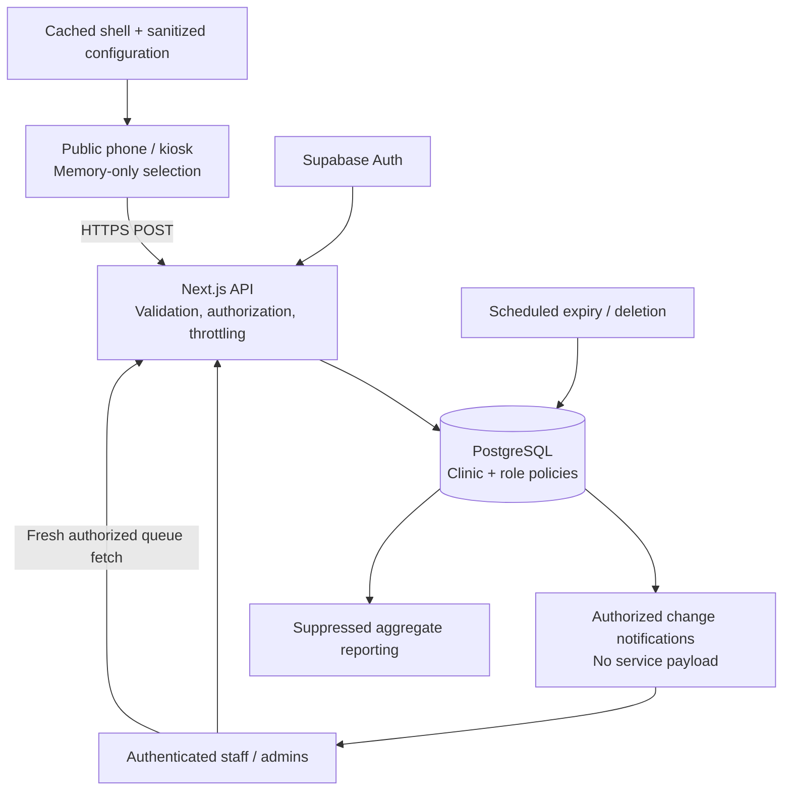

# HealthKey — proposed implementation plan

Status: **Original review plan, approved in conversation with Zimbabwe and English/Shona/Ndebele confirmed. See README and TESTING.md for implementation status.**  
Prepared: 9 October 2026.  
Source: *HealthKey Platform Development Documentation, MVP v1.0*, all 20 sections, Appendices A–C, and the accompanying master development prompt. The source document governs product scope; proposed engineering details below fill its gaps and are not represented as source requirements.

## 1. Product contract and scope

HealthKey privately routes one anonymous service request to authorized clinic staff, then removes its sensitive contents. Success means a first-time user can complete the core journey in under one minute without an account, speaking, or supplying identity information.

Build the full MVP, including the document's Should-priority communication preferences, aggregate reporting, and optional urgent/private-help category. The shortened HackLab build is an intermediate demonstration, not the final deliverable.

Included: personal phone and clinic kiosk journeys; clinic QR/open-link entry; configured languages and accessibility preferences; exactly one service selection; optional communication preference; private review; anonymous submission, reference code and cancellation; staff queue and assignment; expiry/deletion; offline Private Display Mode; clinic administration, translations and privacy-preserving analytics; minimal platform operations administration; synthetic demonstration environment.

Excluded: youth accounts, identity fields, free-text disclosures, diagnoses, clinical notes, prescriptions, AI advice/chatbots, medical records, payments, patient messaging histories and appointment scheduling. Appendix A supplies provisional categories for synthetic demonstrations; pilot wording requires local review. A printable selector generator remains future scope; clinic physical fallback instructions belong in the MVP operations guide.

## 2. Journeys and interaction rules

### Public phone

Clinic QR/link → neutral welcome → optional language/accessibility settings → one service → optional communication preference (Skip available) → review only the selected service/preference → Send privately → anonymous code and neutral waiting instructions.

Language and accessibility controls remain easy to find without adding mandatory steps. No service appears in a route, document title, QR payload or navigation state. The flow is a memory-only state machine within a neutral clinic route. Confirmation contains no alternative services. Success immediately discards the selected service from the public UI state; retain only the minimum memory needed for the current code/cancellation interaction.

Cancel before submission clears the selection. Cancel after submission attempts server-side cancellation only while the request is pending and requires its secret capability. Clear screen clears this device; it does not falsely imply that a delivered clinic request was cancelled. If cancellation cannot be confirmed, say so and offer clearing/direct staff assistance. Closing/reloading clears the public capability; there is no account-based recovery.

### Shared kiosk

Same flow, with prominent Clear and inactivity reset. After submission, discard selection immediately, briefly show the neutral code, then return to welcome. Clear all per-person preferences, tokens and temporary state. Kiosk-wide defaults may persist as clinic configuration, never as the previous person's settings.

Proposed starting values: 90-second idle window, advance warning and an accessible extension control; 20-second neutral receipt screen, also extendable. These are adjustable demo defaults, not approved clinic policy. Test timing adjustment against WCAG 2.2.2/2.2.1 as applicable; do not sacrifice accessibility to an arbitrary timer. Back/forward navigation, bfcache restoration, reload, duplicate tabs and interrupted submission must never restore a prior selection.

### Offline / uncertain delivery

Cache only application assets, reviewed translations and sanitized clinic configuration. A previously loaded device can use this cached menu. First-use offline access cannot download an app; clinic physical selectors/staff assistance are the fallback.

Private Display Mode explicitly says the request has not been confirmed as sent and lets the user reveal the selected icon/label directly to staff, then clear it. No background sync, persistent outbox or automatic submission when connectivity returns. A disconnected staff screen hides sensitive stale content and cannot offer actionable cached requests; reconnection requires a fresh authorized fetch.

Timeout is not proof of failed delivery. Use an in-memory idempotency nonce and capability with a short-lived server record so an explicit retry/status check can resolve a committed request without creating duplicates. Never automatically replay a POST. If delivery remains uncertain, show truthful instructions and offer display mode; do not invent a success code. Configuration refresh on reconnection must not transmit the selection.

### Staff

Authenticate → clinic/role-scoped queue → acknowledge → assign → start → complete. Show code, selected service, communication preference, waiting time and status only. Text labels distinguish status; color is secondary. A conflict response handles simultaneous staff actions; updates are atomic and version-checked.

Urgent/private-help, when enabled, creates an immediate staff flag with a text label and priority ordering. It never requests an explanation or promises an emergency response. Opening hours and after-hours instructions govern whether online submission is offered; proposed default outside hours is clear clinic guidance without a new queue submission.

### Administration

Clinic admins manage services/order, icon/tactile references, available languages, reviewed wording, communication options, hours/messages, kiosk timeout, request expiry, urgent option and staff roles/service visibility. Wording changes use draft → preview → publish, with versions and who/when metadata. Analytics expose only approved aggregates. Platform admins manage organizations, clinics, security configuration and operational status; request contents are not available by default.

## 3. Architecture

Use one modular Next.js application, strict TypeScript, React, Tailwind and accessible reusable primitives. Use Next.js server route handlers for the API, PostgreSQL through Supabase for operational data, Supabase Auth for staff, and Vercel for proposed hosting. Resolve supported stable versions and provider capabilities during foundation work. No infrastructure is provisioned at this planning stage.



Realtime is a refresh signal, not a separate authorization path. Prefer private Supabase channels that send only a generic queue-changed signal; request contents are fetched through the authorized API. Prove channel authorization and revocation in tests. If provider semantics cannot enforce the required boundary, use authenticated short polling, which the specification explicitly allows. On reconnect, role change, logout or session expiry, drop stale data and reauthorize.

The public database role has no request-table read access. Public creation/cancellation pass through narrowly scoped server operations. Staff database operations carry verified staff identity and enforce row-level policies; a broad service-role credential is not the normal staff query path. Privileged cleanup/admin operations remain server-only and narrowly scoped. Do not trust client clinic IDs, role claims without validation, or service membership supplied in a request body.

### Proposed project structure

```text
src/app/                  Neutral clinic flow, staff/admin routes, API handlers
src/features/public/      Journey state machine, kiosk and private display
src/features/staff/       Queue and request actions
src/features/admin/       Configuration, publication and aggregate reports
src/components/ui/        Accessible primitives and design tokens
src/domain/               Request lifecycle, permissions, retention rules
src/server/               Auth, database operations, throttling, safe logging
src/i18n/                 Message catalogues and localization contracts
supabase/migrations/      Schema, constraints, policies and scheduled functions
supabase/seed/             Synthetic clinics and staff fixtures
tests/                    Unit, integration, browser, privacy and accessibility
docs/                     API, threat model, operations and manual test evidence
```

Staff/admin bundles are separated from the public journey. Public pages contain no third-party trackers, remote fonts, session replay, or marketing scripts. Static shell caching is explicitly allowlisted; private APIs and authenticated pages use no-store and never enter the service-worker cache.

## 4. Data, roles and APIs

Keep the document's organizations, clinics, services, service_translations, staff_users, requests_active, request_events, analytics_daily and clinic_settings tables. Add the minimum fields/tables needed for actual workflows:

- Service permissions for staff and explicit assigned staff/service routing.
- Request version, lifecycle timestamps, hard expiry and a hashed public capability. The short public code is display-only, cryptographically random and unique among active codes in its clinic; collisions retry atomically.
- Short-lived hashed idempotency records, bound to the same capability and clinic, with no service labels in identifiers.
- Versioned clinic configuration/translations and minimal administrative audit events.
- Shared atomic throttle counters with short TTL; no permanent visitor identifier.
- Aggregate wait-time buckets to calculate a labelled estimated median without retaining individual wait-time histories.

Enforce same-clinic relationships in database constraints as well as application validation. Deactivating a service prevents new requests but must not break an already accepted request or erase its required routing context prematurely.

| Role | Allowed scope |
|---|---|
| Public user | Published config; create one request; cancel/check own current request using an unguessable capability |
| Reception/intake | Active queue and permitted lifecycle/assignment actions within own clinic |
| Clinician/counsellor | Only own assigned requests or explicitly authorized service queue within own clinic |
| Clinic administrator | Own clinic configuration, staff permissions, suppressed aggregates; queue access only with a separate operational role |
| Platform administrator | Organizations, clinic provisioning, security and health indicators; no default request-content access |

Proposed lifecycle: new → acknowledged → in_progress → completed. Assignment is a separate authorized action. Cancellation is allowed only from new, following the document's pending-only rule; expiry is server-controlled. Completed, cancelled and expired requests disappear from normal staff access immediately. Document any approved exception before implementation.

Preserve the eight API endpoints in section 10: public clinic config/create/cancel, staff queue/update, admin service list/update and aggregate analytics. Add only supporting endpoints needed for specified workflows: staff session handling, configuration draft/preview/publication, staff/service permissions, platform clinic operations, and capability-protected delivery resolution. Prefer the delivery nonce in a request body and never a capability in a URL. Document every endpoint in OpenAPI with schemas, permission rules, errors and examples.

Reject unknown public payload keys, free text, invalid enum values, inactive clinics/services and cross-clinic IDs. Enforce request-body size limits. Generate timestamps/expiry server-side. Use consistent safe error responses and idempotent mutation semantics. CSRF/Origin protection applies to cookie-authenticated mutations.

## 5. Privacy, security and retention decisions

No youth account, identifying field, fingerprint or sensitive browser storage. Service choices remain out of URLs/history, browser titles, QR codes, client logs, telemetry attributes and notifications. Capability tokens never enter access logs. Staff session cookies are Secure, HttpOnly where supported by the selected server-auth flow, and SameSite; keep credentials out of localStorage. Support password managers, paste and accessible MFA, with stronger authentication required for administrators and proposed for all production staff.

Use TLS, restrictive security headers/CSP, input validation, least privilege and tests for direct-object-reference and role-escalation attacks. Rate limiting uses atomic server counters per short-lived anonymous session and clinic, with clinic capacity controls. Assess any additional coarse network limit against shared clinic networks and provider IP retention; do not claim the hosting provider never sees connection metadata. No CAPTCHA unless observed abuse justifies an accessible solution.

### Proposed synthetic-demo policy, pending approval

| Item | Proposed default |
|---|---|
| Unacknowledged expiry | 60 minutes |
| Maximum active lifetime | 24 hours from creation, including acknowledged/in-progress requests |
| Completion/cancellation | Immediately hidden; sensitive details deleted at the next cleanup run |
| Cleanup schedule | Every minute, with job health and backlog monitoring |
| Request-linked events/capability records | Purged with their request or earlier after their short usefulness window |
| Administrative/security audit | Separate approved schedule; no selection, public code or surviving request linkage |
| Aggregate suppression | Initial threshold of 5, subject to privacy review; suppress complements and unsafe breakdowns too |

All queries independently exclude expired records so a delayed cleanup cannot expose them. Test cleanup repeatedly, concurrently and after failure; aggregates must not double count. Raw detail persists only for its approved operational window. If cleanup/retention health becomes unsafe, stop accepting new requests and offer the explicit fallback.

**Deleting a PostgreSQL row is not immediate deletion from backups, WAL or replicas.** Before a real clinic pilot, inspect provider backup/PITR retention and logging behavior, document the true upper bound and approve the privacy notice. If the required bound cannot be met, adjust the ephemeral storage/backup design before launch. Back up configuration and staff administration under a separate policy where possible. Restore procedures must purge expired data before the restored system accepts users. Do not promise permanent erasure at completion without evidence.

Browser controls cannot prevent an operating-system screenshot or someone photographing the screen. Clear sensitive DOM on appropriate lifecycle transitions and test browser restoration, but include kiosk placement, device management and physical privacy guidance; do not claim control over OS snapshots.

Aggregate reports use fixed permitted breakdowns, minimum group size and complementary suppression to resist subtraction attacks. Do not expose raw events or arbitrary intersecting filters. Language/accessibility statistics are unlinked aggregate counts, never disability inference. Offline fallback counts cannot be complete without offline persistence: count only where a non-sensitive online counter is possible and label undercounting. Report estimated median waits from aggregate buckets; exact median computation needs a separate approved approach if required.

## 6. Proposed design system

Visual thesis: a discreet service counter—warm, clear and precise, with a strong HealthKey identity and little visual noise.

Use the supplied shield/key/cross logo and wordmark as the identity reference. Preserve its geometry and proportions. Keep its teal/blue gradient within the logo; use flat colors throughout the interface. Obtain a source vector if available; do not substitute an unrelated generated logo.

| Token | Proposed value / use |
|---|---|
| Ink | #0B3342 — headings and principal text |
| Primary | #0B6B65 — primary controls |
| Accent | #3457C4 — links and selected emphasis |
| Canvas | #F7F8F5 — warm neutral background |
| Surface | #FFFFFF |
| Secondary text | #52616B |
| Control border | #73848C where contrast is required |
| Focus | Dual light/dark outline, never shadow-only |
| Typography | Locally hosted Inter, suitable language fallbacks; body 16–18px, line height about 1.5 |
| Scale | 4, 8, 12, 16, 24, 32, 48, 64px spacing; rem-based type |
| Shape | 6px controls, 10px selection tiles; restrained borders, minimal elevation |
| Targets | At least 44×44px; primary phone/kiosk targets at least 56px high |

Values are proposals, not verified contrast results. Measure every actual foreground/background/state pairing, including focus, selected, error and high-contrast states.

Public layout: narrow, calm content column; modest logo; one task per screen; consistent back/clear placement; labelled icons; conspicuous selected state; no marketing hero. Staff layout: readable operational queue with a minimal detail panel and explicit actions, responsive to a single-column tablet/mobile view. Admin layout: straightforward grouped settings, publication preview and useful change feedback. Avoid nested cards, decorative charts and animation without purpose.

Primitives include buttons, radio choices, icon+label tiles, language picker, accessible dialog, field error, status announcement, queue row, empty/disconnected state and idle warning. Use native semantics first. Move focus deliberately between journey steps. Screen-reader announcements are neutral by default after submission and do not unnecessarily repeat sensitive labels. Never disable zoom or rely on hover, dragging or color alone. Reordering has keyboard buttons.

Target WCAG 2.2 AA, adding feasible AAA practices such as stronger text contrast. Verify the current finalized W3C Recommendation at foundation and pre-release review; draft standards are not conformance targets. Test 320px reflow, 200% zoom, larger text, forced colors, reduced motion, focus not obscured, accessible authentication, error recovery and all timed interactions. Human screen-reader and target-user evidence remains required.

## 7. Milestones and completion gates

Privacy and accessibility begin in foundation and are tested in every milestone. Each milestone ends with a working demonstration, test evidence, defects fixed and a short record of limitations; rendering alone is not completion.

| Milestone | Objective and deliverables | Required exit evidence |
|---|---|---|
| M0 — Foundation | Approved contracts/assumptions, threat model, role matrix, tokens, schema/RLS, project structure, local synthetic seed and CI | Type/lint/build checks; policy isolation tests; contrast calculations; schema prohibits public identity/free-text fields |
| M1 — Complete public journey | U01–U07, localization framework, one-choice flow, review, real API submission/code/cancel, neutral receipt, kiosk reset and offline fallback | Journey tests, strict schema tests, no URL/storage leaks, timeout/lost-response/idempotency tests, keyboard and responsive review |
| M2 — Staff operations | S01–S03, authentication, scoped queue, acknowledgement/assignment/start/complete, realtime or near-realtime, expiry/deletion | Cross-clinic and clinician-scope denial, role revocation, concurrency, lifecycle and actual scheduled deletion tests; two-device flow |
| M3 — Administration | Service/configuration versioning, reviewed translation publication, hours, staff visibility/permissions, minimal platform admin | Permission escalation denial, safe preview/publish, inactive-service behavior, keyboard reordering, translation fallback tests |
| M4 — Reporting and resilience | Suppressed aggregates, wait metric, privacy-safe monitoring, purge alerts, outage/recovery handling | Small-group/differencing tests, no double counting, log inspection, cleanup outage/recovery and backup/restore rehearsal in synthetic environment |
| M5 — Release candidate | Synthetic demo, complete automation, manual review, documentation and deployment preparation | AC-01–AC-10 evidence, all documented test categories, device matrix, under-one-minute usability study, performance results, pilot blockers explicitly listed |

The document suggests roughly five implementation weeks plus foundation for its sprint sequence; this is a planning reference, not a delivery commitment. External clinical review, translations, accessibility participants and independent security review have separate lead times.

## 8. Requirement traceability

| Source IDs | Implementation / verification |
|---|---|
| FR-001, FR-002 | M1 anonymous clinic welcome and published languages; no-login browser tests |
| FR-003, FR-004, FR-005 | M1 exactly one category, optional configured preference, selected-only review; state and schema tests |
| FR-006 | M1 cryptographic display code and secret capability; collision/guessing tests |
| FR-007, FR-008 | M2 authenticated clinic/role queue and lifecycle/assignment; realtime, concurrency and authorization tests |
| FR-009 | M2 server expiry, queue exclusion and cleanup; clock/scheduler tests |
| FR-010, FR-011 | M1 kiosk reset and explicit display fallback; browser history/storage/network inspection |
| FR-012 | M3 versioned menu configuration and keyboard-accessible ordering |
| FR-013 | M4 aggregate counts/status/wait metrics with suppression |
| FR-014 | M2–M4 security-sensitive audit with tested redaction and retention |
| FR-015 | M1/M2 optional urgent category and authorized staff attention flag |
| NFR-01 | Performance budget and measured public interaction under 3 seconds on an explicitly recorded typical-mobile test profile |
| NFR-02 | Clinic-hours availability target at least 99%; production measurement/runbook, plus previously cached offline fallback |
| NFR-03 | WCAG 2.2 AA acceptance checklist, automated and human evidence |
| NFR-04, NFR-05 | Threat model, privacy constraints, TLS/auth/role tests and verified retention |
| NFR-06 | Current Android/iOS and desktop kiosk browser testing |
| NFR-07 | Externalized public strings, configured catalogues and reviewed publication |
| NFR-08 | Strict types, typed API/schema, migrations, lint, tests and deployment workflow |

| Acceptance criterion | Required evidence |
|---|---|
| AC-01 | Anonymous browser reaches selection without authentication |
| AC-02 | URLs/history inspected through every public state; no service identifiers |
| AC-03 | Submit/reset/Back and bfcache scenarios cannot recover prior kiosk choice |
| AC-04 | Clinic A credentials fail API, database and realtime attempts against Clinic B |
| AC-05 | API rejects unknown/free-text fields and invalid/inactive/cross-clinic service IDs |
| AC-06 | Expired request excluded immediately even with cleanup delayed |
| AC-07 | Completion causes real aggregate/deletion execution within the configured bound |
| AC-08 | Offline/timeout/reconnect produce no automatic request POST or persistent sensitive outbox |
| AC-09 | Accessible names, semantics and keyboard/focus tests for every control |
| AC-10 | Full public journey at 200% zoom, plus 320px reflow |

Use Vitest for domain/schema tests, an isolated real PostgreSQL/Supabase test environment for API/RLS/retention integration, and Playwright plus axe for browser checks. Include success, rejection, network outage, lost response, double-click, concurrent update, expiry, session revocation and cleanup failure. Automation runs with synthetic data only. Manual matrix covers VoiceOver/Safari, NVDA with a supported desktop browser, TalkBack/Chrome, keyboard-only operation, mobile touch, forced colors and kiosk deployment practices. Record executed versus pending tests separately; a scanner pass is not a compliance declaration.

## 9. Deployment and handoff

Separate local, preview, staging/demo and production environments. Preview must never connect to production data. Prefer dedicated demo projects with synthetic clinic seeds, restricted staff demonstration credentials, obvious demo context and safe reset instructions. Public demo access remains anonymous; do not weaken production staff authentication to make a demo convenient.

Environment contract will cover database/auth credentials, application origin, request TTL/hard maximum, kiosk timers, analytics minimum group size, scheduler credentials, safe monitoring configuration and any rate-limit secrets. Keep privileged values server-only and out of Git; document public versus private keys. Confirm provider regions, credentials, operational plan limits, scheduler frequency and processing terms before provisioning for clinic use. This session currently reports no configured environment secret bindings.

CI will check types, lint, unit/integration/browser tests and build; migrations are reviewed and applied through a documented release process. Provide deployment, rollback, configuration backup/restore, purge verification, incident response, staff onboarding/revocation and kiosk setup runbooks. Avoid raw production data in preview or support tooling.

Final handoff includes application source; database migrations/diagram; OpenAPI; role matrix/threat model/retention policy; design tokens/primitives; automated suites and recorded results; manual test checklist/results; synthetic demo guide; .env.example; setup/architecture/maintenance README; deployment instructions; release limitations and independent-review requirements.

Release-candidate completion is separate from authorization for real clinic use. Pilot gates: approved jurisdiction/data handling and provider configuration; clinical/safeguarding wording; community-reviewed translations; target-user usability sessions; accessibility evaluation; independent security review; deletion/backup evidence; named operations owner and staff training. No security, legal or WCAG certification is claimed by this plan.

## 10. Decisions requested at plan review

1. **Pilot jurisdiction:** Which country will host the first pilot, and are there data-residency requirements? The document mentions Zimbabwe as a localization example, not a confirmed deployment location.
2. **Languages and reviewers:** Which languages must launch, and who will validate the service wording, safeguarding copy and translations? Proposed starting point: English for synthetic development, with Shona/Ndebele only if the Zimbabwe pilot is confirmed and reviewers are available. The multilingual architecture is part of the MVP regardless.
3. **Operational defaults:** May the proposed synthetic-demo values be used initially—60-minute unacknowledged expiry, 24-hour hard maximum, deletion on the next one-minute cleanup, 90-second extendable kiosk idle timeout and group threshold 5? A named clinic owner must approve production values and backup retention before pilot launch.

Approval of this plan authorizes milestone implementation using its explicit demo assumptions; it does not establish clinical validation or authorize use of real patient/request data. No application code, infrastructure or external deployment has been created during this planning stage.
